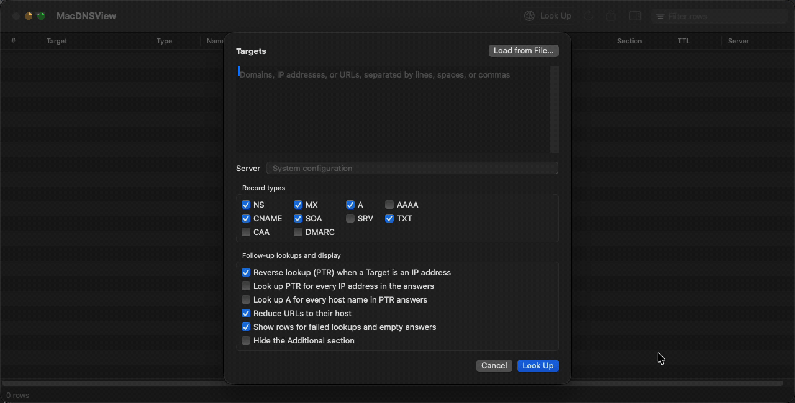

# MacDNSView

Look up DNS records for many domains and IP addresses at once, against your system resolver or any DNS server, and export the results. A native macOS app plus a CLI.



Status: early releases. Expect rough edges.

## Features

- Record types: A, AAAA, CNAME, MX, NS, SOA, SRV, TXT, CAA, DMARC, and PTR for IP addresses.
- Any DNS server, or the system configuration including VPN scoped servers.
- TTL, response section, answering server, and response time on every row.
- Export to CSV, TSV, JSON, plain text, and HTML.
- CLI for scripts: `macdnsview example.com 1.1.1.1 --type A,MX --format json`

## Install

Requires macOS 14 or later.

### Homebrew

```
brew install ebudist/tap/macdnsview
```

This builds the `macdnsview` CLI and `MacDNSView.app` from source on your Mac, so Gatekeeper does not block them. To open the app from Launchpad and Spotlight, link it into Applications:

```
ln -sf "$(brew --prefix)/opt/macdnsview/MacDNSView.app" /Applications/MacDNSView.app
```

### Download

Universal zips for the app and the CLI are on [Releases](https://github.com/ebudist/macdnsview/releases). They are not notarized, so clear the quarantine flag after unzipping: `xattr -dr com.apple.quarantine MacDNSView.app macdnsview`.

## Build

Requires macOS 14 and Swift 6 (Command Line Tools are enough).

```
swift build
swift test -j 1
swift run macdnsview example.com 1.1.1.1
swift run macdnsview --help
scripts/bundle.sh    # universal MacDNSView.app and CLI, zipped into dist/
```

## Credits

Inspired by [DNSDataView](https://www.nirsoft.net/utils/dns_records_viewer.html) by Nir Sofer, which is Windows only. MacDNSView is an independent reimplementation and is not affiliated with NirSoft.

## License

MIT
